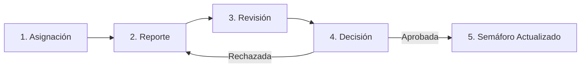

# MANUAL DE USUARIO - CONTROLAND
**Sistema de Gestión y Seguimiento del Plan de Desarrollo Municipal**

---

## 1. INTRODUCCIÓN Y PROPÓSITO DEL SISTEMA
**Controland** es la herramienta oficial de la administración para realizar el seguimiento, control y evaluación del Plan de Desarrollo Municipal. Permite a cada secretaría reportar periódicamente el avance físico y financiero de sus metas, respaldar cada cifra con documentos probatorios válidos (archivos y enlaces) y registrar la ubicación geográfica de las obras en el mapa del territorio.

### 1.1 Beneficios Principales para los Funcionarios
* **Claridad en las Metas:** Visualice en un solo lugar los compromisos, indicadores y metas anuales asignados a su dependencia.
* **Facilidad de Reporte:** Cargue evidencias documentales y fotográficas directamente desde cualquier computador con conexión a internet.
* **Control de Plazos:** Conozca con anticipación las fechas límite de reporte y evite rezagos o alertas en la rendición de cuentas.
* **Seguimiento Territorial:** Localice las obras públicas en el mapa oficial para mostrar el impacto en barrios, veredas y comunas.

### 1.2 Estructura Dinámica y Adaptable del Plan de Desarrollo
> ℹ️ **Estructura Flexible:** La jerarquía del árbol del Plan en Controland es completamente **dinámica** y se adapta a las necesidades y a la metodología adoptada por cada entidad o municipio (aprobada por Acuerdo Municipal o Decreto).

El sistema no impone un esquema rígido; según la configuración de la entidad territorial, el árbol puede estructurarse en 3, 4, 5 o más niveles jerárquicos:

| Modelo de Entidad | Niveles Jerárquicos en el Sistema | Nivel de Reporte |
| :--- | :--- | :--- |
| **Esquema de 3 Niveles** | Eje Estratégico &rarr; Programa &rarr; **Meta de Producto** | Meta de Producto (Hoja) |
| **Esquema de 4 Niveles** | Línea Estratégica &rarr; Sector &rarr; Programa &rarr; **Meta de Producto** | Meta de Producto (Hoja) |
| **Esquema de 5 Niveles** | Línea &rarr; Sector &rarr; Programa &rarr; Subprograma &rarr; **Meta de Producto** | Meta de Producto (Hoja) |

El sistema genera automáticamente la navegación, los filtros y la consolidación de cálculos respetando la estructura configurada para el municipio. *Independientemente del número de niveles superiores, el nivel final sobre el cual el funcionario siempre reporta avances y evidencias es la **Meta de Producto (nivel hoja)**.*

---

## 2. PERFILES DE USUARIO Y NIVELES DE ACCESO
* **Secretaría / Reportante:** Consulta las metas asignadas a su dependencia, reporta avance físico/financiero, anexa soportes (actas, fotos, enlaces web) y marca coordenadas en el mapa.
* **Planeación / Supervisor:** Supervisa el semáforo de cumplimiento de todo el plan, revisa y audita los documentos subidos por cada secretaría, valida (aprueba) o solicita corrección (rechaza) de evidencias, y descarga reportes en Excel.
* **Administrador:** Crea usuarios, asigna secretarías, configura fechas límite de reporte (fechas de corte) y actualiza la estructura general del plan.
* **Ciudadano / Control Social:** Consulta pública del avance de las metas y radicación de solicitudes ciudadanas (PQRS).

---

## 3. CICLO DE REPORTE Y SEMAFORIZACIÓN

### Código de Colores del Semáforo
* **0% a 39% (Rojo):** Crítico. Meta con atraso considerable. Requiere acciones correctivas urgentes.
* **40% a 69% (Naranja):** Alerta. Ejecución por debajo de lo previsto. Requiere acelerar contrataciones u obras.
* **70% a 89% (Amarillo):** Aceptable. Avance adecuado con pequeños pendientes por certificar.
* **90% a 100% (Verde):** Exitoso. Meta cumplida conforme a lo programado para la vigencia.
* **Más del 100% (Azul):** Destacado. La secretaría superó la cantidad programada para el año.

---

## 4. ACCESO AL SISTEMA Y MENÚ PRINCIPAL

### Paso 1: Inicio de Sesión
1. Ingrese al portal institucional con su correo institucional y contraseña.
2. El sistema reconocerá automáticamente su entidad y le dará ingreso directo a su Plan de Desarrollo.

> 🖼️ **[FIGURA 1: Pantalla de Inicio de Sesión]**  
> *Espacio reservado para captura de pantalla del formulario de Login institucional.*

### Paso 2: Menú Principal (Panel del Plan)
Acceda a los módulos activos según su perfil: Plan Indicativo, Mapa de Intervención, POAI, Banco de Proyectos y PQRS.

> 🖼️ **[FIGURA 2: Menú Principal con Tarjetas de Módulos]**  
> *Espacio reservado para captura del menú principal de bienvenida con acceso a los módulos operativos.*

---

## 5. GUÍA DE TAREAS: SECRETARÍAS Y REPORTANTES

### Tarea 5.1: Localizar la Meta que Desea Reportar
1. En el menú principal, haga clic en la tarjeta **Plan Indicativo**.
2. Navegue en la estructura haciendo clic en su línea, sector y programa correspondiente.
3. Encuentre la **Meta de Producto** asignada a su secretaría y haga clic para abrir su ficha completa.

> 🖼️ **[FIGURA 3: Navegación del Árbol de Metas en el Plan Indicativo]**  
> *Espacio reservado para captura de pantalla de la estructura del árbol y los semáforos de cumplimiento.*

### Tarea 5.2: Abrir el Formulario de Reporte
Dentro de la ficha de la meta, revise la cantidad programada y el acumulado actual, y haga clic en el botón superior **"Adicionar Reporte / Evidencias"**.

> 🖼️ **[FIGURA 4: Ficha de la Meta y Botón de Reporte]**  
> *Espacio reservado para captura de la ficha técnica de la meta con el botón para reportar evidencias.*

### Tarea 5.3: Diligenciamiento Completo del Reporte de Evidencia
El formulario agrupa la información probatoria en 5 bloques continuos:

| Bloque del Formulario | Campos a Diligenciar | Instrucciones Prácticas |
| :--- | :--- | :--- |
| **1. Actividad y Cantidad** | • Vigencia (Año) • Descripción de Actividades • Unidad de Medida • Cantidad Física | Redacte de forma detallada las obras o bienes entregados. Indique la cantidad física lograda (mayor a 0) en la unidad oficial de la meta. |
| **2. Ubicación Territorial** | • Comuna / Corregimiento • Barrio / Vereda | Seleccione la zona beneficiada. Si la obra impacta todo el municipio, elija la opción *Todas*. |
| **3. Coordenada en Mapa** | • Punto GPS en mapa interactivo | Pulse el botón de mapa, haga un clic sobre el lugar exacto de la intervención territorial hasta ver la confirmación verde *"Ubicación asignada"*. |
| **4. Población y Recursos** | • Grupo Poblacional • No. Beneficiados • Recursos Ejecutados ($) • Fuente de Financiación | Indique el grupo humano beneficiado, el número de personas y el valor presupuestal ejecutado con su respectiva fuente (ICLD, SGP, Regalías, etc.). |
| **5. Soportes (PDF y Web)** | • Archivo PDF (Actas, fotos) • Enlace Web (Drive, SECOP) • Nombre, Lugar y Fecha | Pulse *"+ Agregar Soporte"*. Adjunte el PDF con actas y fotos, o pegue el enlace web iniciando con `https://`. Indique nombre, lugar del archivo y fecha. |

> 🖼️ **[FIGURA 5: Formulario de Reporte de Evidencias - Datos Generales]**  
> *Espacio reservado para captura de pantalla de los campos de actividades, cantidades, población y recursos financieros.*

> 🖼️ **[FIGURA 6: Selector Geográfico en Mapa y Carga Dinámica de Soportes]**  
> *Espacio reservado para captura de la ventana interactiva de mapa y la sección para adjuntar archivos PDF y enlaces web.*

> 💡 **Recomendación práctica:** Recomendamos unir el acta de recibo a satisfacción y el registro fotográfico en un solo documento PDF antes de subirlo.

Haga clic en **"Guardar Evidencia"** para confirmar el envío.

---

## 6. GUÍA DE TAREAS: PLANEACIÓN Y SUPERVISIÓN

### Tarea 6.1: Monitoreo y Auditoría
1. Ingrese a **Plan Indicativo** y revise el semáforo de cumplimiento.
2. Abra la meta a auditar y haga clic en **"Ver Evidencias"** para revisar la lista cronológica de reportes.
3. Abra los archivos PDF o enlaces web para contrastar firmas y valores contractuales.

> 🖼️ **[FIGURA 7: Bandeja de Revisión y Auditoría de Evidencias]**  
> *Espacio reservado para captura del listado de evidencias reportadas con opciones de descarga y revisión.*

4. **Aprobar:** Confirma el avance oficial e impacta el semáforo de cumplimiento.
5. **Rechazar / Devolver:** Registra la observación para que la secretaría corrija el soporte.

### Tarea 6.2: Descarga de Reportes en Excel
Haga clic en **"Exportar a Excel"** en la cabecera del Plan Indicativo para obtener la sábana completa con programación y ejecución física y financiera.

---

## 7. MÓDULOS ADICIONALES

### 7.1 Mapa de Intervenciones Territoriales
Muestra sobre el mapa municipal la distribución territorial de todas las obras y reportes registrados.

> 🖼️ **[FIGURA 8: Visor Geográfico de Obras y Reportes]**  
> *Espacio reservado para captura de pantalla del mapa territorial con marcadores georreferenciados.*

### 7.2 PQRS (Atención Ciudadana)
Canal para radicar y gestionar solicitudes ciudadanas con seguimiento a términos de ley.

> 🖼️ **[FIGURA 9: Bandeja de Gestión de Solicitudes Ciudadanas (PQRS)]**  
> *Espacio reservado para captura del panel de peticiones ciudadanas y seguimiento de tiempos de respuesta.*

---

## 8. CATÁLOGOS OFICIALES DE CONSULTA RÁPIDA

### Grupos Poblacionales
`AdultoMayor`, `Afrodescendientes`, `Adolescentes` (Niños, Niñas y Adolescentes), `Discapacitados`, `Indigenas`, `Jovenes`, `Mujeres`, `Victimas`, `Todos` (Población General).

### Fuentes de Recursos
`RecursosPropiosICLD` (Libre Destinación), `RecursosPropiosICDE` (Destinación Específica), `SGP` (Participaciones), `Regalias`, `Credito`, `Cofinanciacion`.

---

## 9. PREGUNTAS FRECUENTES Y SOLUCIÓN DE ERRORES
* **"El archivo debe ser PDF":** Guarde o convierta el documento a formato `.pdf` antes de subirlo.
* **"El enlace debe iniciar con http:// o https://":** Escriba el protocolo completo al inicio de la URL.
* **"Ubicación no asignada" en rojo:** Abra el botón de mapa y pulse sobre el punto geográfico de la obra hasta ver la confirmación verde.
* **Botón de guardar bloqueado:** La fecha límite de reporte (fecha de corte) ya venció. Solicite autorización formal de apertura a Planeación.
